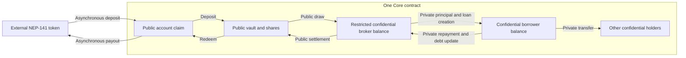

# NEAR Confidential Lending Protocol

Version: 0.1  
Status: Draft protocol specification  
Date: 2026-11-06  
Primary track: Privacy & Private AI

## 1. Purpose and conformance

This protocol provides broker-underwritten confidential lending on NEAR. Lenders hold public shares in a single-asset vault. A broker allocates vault capital to loans agreed with borrowers. Loan amounts, repayment amounts and confidential balances are encrypted, while contracts enforce authorization, conservation of funds and valid loan transitions.

The economic baseline is the supplied Zeno Confidential Lending Protocol draft, dated 2026-10-25, combined with ordinary XRPL lending and cash-basis vault behaviour from the pinned rippled 3.4.1 reference. Section 3 identifies the intentional differences. This is an application protocol implemented by NEAR contracts; it does not require a NEAR consensus amendment.

MUST, MUST NOT, SHOULD and MAY express normative requirements. Equations describe integer values, including private witnesses; they do not authorize publishing those witnesses. An implementation is conformant only when its contracts, circuits, wallet, indexer and operational services agree on these rules.

This document defines the financial state machine and proof obligations. A deployed release additionally requires the immutable cryptographic profile and artifacts specified in section 7. An unreviewed verifier or a mocked proof is not a conformant implementation.

## 2. Product and credit model

- The broker conducts underwriting off-chain. Origination requires authorization from both broker and borrower over the same agreement.
- The protocol does not require on-chain borrower collateral and does not provide automated collateral liquidation.
- The vault uses cash-basis accounting. Agreed future finance charges are not recognized as realized yield at origination.
- The agreed initial amount owed may exceed principal. There is no time-accruing interest, late fee, origination fee, service fee, management fee or overpayment fee.
- First-loss cover is disabled: cover balances and cover rates are zero; cover deposit, withdrawal and liquidation operations are unavailable.
- Borrowers may use funded assets through confidential transfers. A loan is not a restriction on the borrower's other funds.
- Proofs establish correct accounting and authorization. They do not establish creditworthiness, authenticity of off-chain documents, or future repayment.
- Lenders bear the disclosed credit and liquidity risk. A vault share is a claim under the vault's accounting and withdrawal rules, not a guaranteed redemption at its original purchase price.
- Broker settlement requires an operating prover with access to the broker's private state. Automation reduces routine work but does not eliminate this liveness dependency.

## 3. Relationship to the XRPL draft

| Component | Preserved behaviour | NEAR implementation or approved change |
| --- | --- | --- |
| SingleAssetVault | Public deposits, shares, assets available, asset totals and phase restrictions | Internal vault ledger backed by custody of a configured NEP-141 asset |
| LoanBroker | Public owner, vault association, aggregate debt and debt ceiling | Logical broker identity inside the Core contract |
| Lending balance | Restricted confidential spending balance and inbox | Co-resident encrypted account records |
| Origination | Joint agreement, private principal transfer, encrypted terms | A signed proposal and an atomic proof-verified contract call |
| Repayment | Borrower pays the broker privately; public vault accounting is unchanged | Regular payment MUST be strictly less than the amount owed |
| Full payment | Equality proof and public closure | All amount-owed ciphertexts become encrypted zero and the loan version increments |
| Inbox merge | Owner-authorized merge; incoming credits do not invalidate spending proofs | Wallet orchestrates merge and proof preparation automatically when needed |
| Settlement | Public amount; debt repaid first and excess recognized as yield | Broker may delegate narrowly scoped merge/settlement execution |
| Default | Broker authorization after due date plus grace; public default status | Complete aggregate loss recognition, including repayment allocation and prior settlements |
| Asset movement | Private movements conserve actual assets | Internal lending movements are atomic; external token transfers have a separate recoverable state machine |
| Deletion | Closed loans can be deleted by their parties | Deletion never forgives broker debt or destroys evidence needed for loss accounting |

XRPL transaction type numbers, fee multipliers, error numbers, wire encodings and proof byte lengths are not portable NEAR requirements. Equivalent authorization and financial behaviour is required. New accounting and proof rules in this specification take precedence over the supplied draft where explicitly stated.

## 4. Roles and public visibility

### 4.1 Roles

| Role | Authority | Confidential access |
| --- | --- | --- |
| Lender | Deposit, hold/transfer permitted shares, redeem shares | Their own wallet secrets; no automatic access to individual loans |
| Vault owner | Configure a new vault, authorize its broker and permitted configuration updates | No decryption right solely from vault ownership |
| Broker owner | Approve loans, draw, merge, settle, manage delinquency and scoped delegates | Broker lending balance and that broker's loan terms |
| Borrower | Accept a loan, manage their private balance, transfer and repay | Their own balances and loan terms |
| Asset issuer/controller | Exercise only the asset's declared authorization/freeze capabilities | Issuer-encrypted transfer amounts and balance mirrors |
| Token auditor | Read the asset-level audit view | Token transfer amounts and holder/broker balance mirrors |
| Loan auditor | Read a particular loan's audit view | Principal, amount owed, periodic payment and that loan's repayments |
| Keeper | Submit specifically delegated broker operations | Only private state actually provisioned to that service |
| Relayer | Submit an already authorized payload | No decryption right from relaying |

NEP-141 does not define a universal issuer identity or confidential-auditor interface. A supported asset MUST have an explicit, immutable controller identity and audit configuration in its AssetProfile. The UI MUST identify whether that controller is the underlying issuer or an issuer-authorized wrapper operator. These identities MUST NOT be silently presented as interchangeable.

### 4.2 Public data

The following remain public:

- Account IDs of borrowers, lenders and brokers; loan existence and associations.
- Loan IDs, proposal IDs, public payment schedule, grace period, remaining payment count, status and state versions.
- Vault asset, owner, phase configuration, share balances/supply and accounting totals.
- Broker debt, debt ceiling, draws, settlements and their amounts.
- Public deposits, redemptions, unshielding and external payout amounts and destinations.
- Ciphertexts, commitments, proofs, authorization keys, audit public keys and transaction metadata.
- Aggregate accounting results, including published impairment provisions and realized loss adjustments.

Principal, amount owed, periodic payment, individual repayment amounts and confidential balances MUST NOT appear in plaintext arguments, events, logs, errors, analytics or public storage. Their authorized encrypted views are public ciphertexts.

Amount confidentiality does not imply hidden account relationships, transaction timing or network metadata. Public boundary amounts can correlate with private activity. Publishing an aggregate with one contributing loan can reveal that loan's amount. The application MUST describe this limitation next to its aggregate loss policy, not advertise aggregation as an anonymity guarantee.

Changing an auditor for future loans does not revoke ciphertexts or plaintext already obtained by an earlier auditor. A loan's auditor and encryption-key versions are fixed at origination.

## 5. Deployment and custody architecture

One Core deployment supports exactly one underlying asset and may contain multiple vaults, brokers, loans and confidential holders. The token contract account and asset decimals are immutable.

The Core holds the actual NEP-141 tokens in its own account. It maintains distinct internal ledgers for:

1. Public vault liquidity.
2. Public withdrawable account claims.
3. Confidential holder and broker balances.
4. External payout reservations.

Loan receivables and vault shares are financial claims, not additional tokens. They MUST NOT be counted as token custody.

Draw, origination, confidential transfer, merge, repayment, internal settlement and accounting checkpoints execute within this Core. They MUST NOT split their financial changes across separate contracts or defer proof verification to a callback.

An internal settlement converts broker confidential funds into the associated vault's public liquidity. It does not call the external token contract. An external payout happens only when an account withdraws a public claim.

All arrows inside the Core represent atomic transitions. Inbox merge precedes spending when incoming funds are needed. The external arrows use the receipt/reservation state machines in section 18.

Shares are public entries in the Core's vault-share ledger. A wallet or token adapter MAY expose them through another interface, but it MUST NOT mint, redeem or transfer claims independently of the Core. Integrations do not alter the authoritative share supply.

Contract code, cryptographic profile and verifier keys for existing positions MUST NOT be replaceable by an unrestricted administrator. A release MUST disclose its upgrade policy and enforce immutable existing-position rules or an explicitly authorized migration. No administrative key may manufacture a successful proof, erase debt, or redirect payout reservations.

## 6. Values, time and identifiers

### 6.1 Amounts

All asset amounts use integer base units. No floating-point arithmetic is permitted.

- MAX_ASSET_UNITS is 2^63 - 1 per Core deployment.
- Holder spending plus inbox balances, public claims, vault amounts and broker debt are bounded by this cap.
- The total represented custody across all rails MUST remain within the cap.
- Cumulative accounting counters use checked unsigned 128-bit integers.
- Aggregate private principal sums and C + H + I use checked unsigned 128-bit integers. Receivables are not custody and may exceed the single-balance cap. Each loan's P/O/Q/R is bounded by MAX_ASSET_UNITS; an active-loan count is a checked u64, so the aggregate bounds can be established inductively without requiring a borrower to decrypt the broker's other loans.
- Share balances and supply use checked unsigned 128-bit integers.
- Intermediate multiplication/division uses a checked representation sufficient for the full product, at least 256 bits for share pricing.
- Circuits MUST constrain integer ranges and carries. Equality modulo a field is not sufficient evidence of integer conservation.
- JSON represents monetary values and shares as decimal strings. A typed canonical encoding is used for signatures and proofs.

### 6.2 Time

Contract time is floor(block_timestamp_ns / 1,000,000,000), in Unix seconds. Local browser time is advisory.

Payment interval is a positive integer number of seconds; payment count is a positive u32. The release fixes max_payment_count within that range. Times use checked u64 seconds; the complete schedule, final due date and grace deadline must fit. Grace period is nonnegative. Default is permitted only when now is strictly greater than next_payment_due + grace_period, matching the modern rippled exclusive deadline rule.

start_time is the successful origination call's contract time. The proposal explicitly authorizes this activation-time rule and an expiry; it does not silently accept a broker-supplied backdated start. Initial previous_due is zero and next_due is start_time + payment_interval. A regular payment advances the due date by one interval even if submitted late. Paying more than the periodic minimum does not skip additional installments unless it closes the loan.

### 6.3 Identifiers and replay protection

Vault, broker, loan, operation and proposal identifiers are domain-separated 32-byte hashes or monotonically allocated IDs unique within a Core. The implementation MUST define their canonical derivation in its release manifest.

A proposal has a borrower-visible unique ID and expiry. Consumed or revoked proposal IDs cannot be reused. Payout operation IDs and checkpoint IDs are permanent tombstones after completion; deletion of a display record MUST NOT make an ID reusable.

## 7. Cryptographic profile and authorization

### 7.1 Required properties

A CryptoProfile is immutable and identified by the hash of its complete manifest. It MUST define:

- Curve and subgroup, point/scalar encodings, subgroup checks and identity-point rules.
- Additively homomorphic encryption for balances and amounts, with domain-separated canonical zero and specified rerandomization.
- Binding, hiding commitments; domain-separated hashing and transcript construction.
- Proof-of-possession for encryption keys.
- Sound zero-knowledge proofs for all statements in this specification.
- Exact integer bounds, ciphertext consistency rules, transcript order, proof encodings, length limits and verification keys.
- Prover, verifier and wallet artifact versions/hashes, setup assumptions and reproducible test vectors.
- Recovery/scanning of encrypted amounts and the treatment of recovery hints.

The proof system MAY use an existing reviewed SNARK construction and supported NEAR verification primitives. The existence of a NEAR pairing host function alone is not evidence that a particular lending circuit is secure or fits the gas limit. The release MUST pin a concrete suite and demonstrate its complete proof path; it MUST NOT copy the XRPL draft's proof lengths into an unrelated verifier.

Ciphertexts encrypted to different authorized readers MUST be proved to represent the same amount. Loan-auditor ciphertexts and issuer/token-auditor mirrors are part of that statement, not optional unverified attachments. Transfer amounts have five relevant views during lending; stored O/Q terms have the three loan readers. Token-level audit access does not automatically grant access to those future debt terms.

For additive encryption of an amount as a group element, decryption may require recovering a bounded discrete logarithm. The wallet MUST have a practical, tested recovery method across the declared amount range. Local caches alone are not an adequate recovery strategy. Any encrypted recovery hint MUST authenticate its account, asset, profile, key ID and corresponding ciphertext digest/version and be checked against that ciphertext. Hints are wallet recovery aids, never state authority; malformed hints cannot authorize funds or change accounting.

### 7.2 Authorization is separate from proof validity

A valid balance proof does not authorize an account operation by itself. Every operation also requires a direct authorized call or a valid operation signature from a registered authorization key.

An account registers or revokes an application authorization key through a call authenticated as that account. An encryption key is registered with proof of possession. Authorization-key epochs are public, monotonic and included in signed payloads.

Encryption keys MUST NOT be overwritten while associated nonzero balances or open loans depend on them. Rotation requires a fully specified proof-verified migration or closing those positions. Stored audit ciphertexts retain their original key identifiers. There is no administrative reset that grants access to an encrypted balance.

### 7.3 Canonical binding

The release uses a single canonical typed encoding, such as a pinned Borsh schema. Hashing ad hoc JSON text is prohibited.

Every operation proof binds at least:

    protocol domain and version
    network ID and Core account ID
    underlying asset and CryptoProfile hash
    operation type and unique operation/proposal ID
    vault, broker and loan IDs where applicable
    all affected account IDs and encryption-key IDs
    authorization-key/delegate epochs and expiry
    expected spending and loan versions
    accounting/book versions where affected
    exact stored pre-state ciphertexts, commitments and roots used by the proof relation
    all public amounts, flags, commitments and output ciphertexts
    the complete signed agreement digest when originating a loan

network_id is an immutable deployment parameter checked by wallets against their selected network; this specification does not assume a network-ID host function. Direct calls use the authenticated predecessor as their authority, never an arbitrary account argument or a forwarded original signer. Relayed calls verify the registered key's complete operation signature and consume its nonce.

Signatures exclude their own signature bytes; proof transcripts exclude their own proof bytes. The manifest defines the exact preimage schemas and domain tags. Omitting an effect from the public statement is a verification defect.

The verifier obtains required pre-state values from current Core storage and compares them with the proof statement. A caller-supplied alternative balance, loan or aggregate is not authoritative. A pure inbox credit is applied homomorphically to the current destination inbox; it does not require a proof against the destination's earlier inbox. This exception preserves the spending/inbox independence without permitting arbitrary replacement of either balance.

Version increments MUST be checked for overflow. A stale expected version fails before any state change. An invalid proof, malformed point, wrong profile or revoked authorization fails without a financial effect.

### 7.4 Off-chain agreement

The broker and borrower authorize one Proposal containing the asset, broker/vault, their account/key IDs, loan auditor key, encrypted P/O/Q, payment count, interval, grace period, activation-time rule, expiry and all required commitments.

The borrower wallet MUST decrypt and display the agreed terms and verify their relationship to the proposal before authorization. A human-readable preview must derive from the signed data.

The funding proof binds the proposal digest and current broker spending state. It may be regenerated against a later spending version without changing the agreed terms, provided both proposal authorizations remain valid and unexpired. Changes to terms, parties, auditor or asset require a new proposal authorization.

## 8. State records

### 8.1 AssetProfile

| Field | Meaning |
| --- | --- |
| token_account, decimals | Immutable underlying NEP-141 asset |
| token_trust_policy | Reviewed transfer semantics, token upgrade authority and supported recovery assumptions |
| controller_account | Declared issuer or authorized wrapper controller |
| issuer_key, token_auditor_key | Required encryption public keys with immutable IDs |
| crypto_profile_hash | The release's approved profile |
| authorization_policy | Permissionless or explicit holder authorization |
| freeze_policy | Declared authority and account/asset freeze behaviour |
| confidential_outstanding | Public amount represented in confidential balance rails |
| custody_cap | MAX_ASSET_UNITS or a lower immutable cap |

Asset registration MUST reject fee-on-transfer, rebasing or other token semantics that violate the transfer accounting assumed here, unless an explicit reviewed adapter normalizes those semantics. Underlying issuer powers and transfer restrictions must be disclosed.

### 8.2 Vault

| Field | Meaning |
| --- | --- |
| vault_id, owner | Public identity and authorized owner |
| asset_id | The Core's underlying asset |
| assets_total (T) | Public book assets before current impairment provision |
| assets_available (A) | Public liquidity available for allocation/redemption |
| loss_unrealized (U) | Published aggregate impairment provision |
| shares_total (S), shares | Public share supply and holdings |
| assets_maximum | Zero for unlimited, otherwise the configured cap |
| kind, phase_times | Open-ended or closed-ended subscription/investment/redemption schedule |
| share_scale | Immutable initial share precision |
| shares_transferable | Public share-transfer policy |
| checkpoint_policy | Immutable accounting cadence and aggregate disclosure policy |
| accounting_pending | Whether an unresolved risk-state change prevents NAV-priced operations |
| accounting_version | Version incremented on every financial change |

Share NAV is T - U. It is a protocol book value, not an external fair-value assertion about credit quality.

### 8.3 Broker

| Field | Meaning |
| --- | --- |
| broker_id, owner, vault_id | Public identities and immutable vault association |
| encryption_key_id | Broker's confidential lending key |
| debt_total (D) | Aggregate outstanding vault capital under section 16 |
| debt_maximum | Public draw ceiling; zero means unlimited |
| loan_sequence, active_loan_count, impaired_loan_count | Public lifecycle counters; counts track Active loans and their impaired subset |
| spending, inbox | Restricted confidential balance |
| spending_version | Increments on debit or merge; incoming credits do not increment it |
| issuer_balance, auditor_balance | Encrypted mirrors of total broker holdings |
| loan_book_root, book_version | Authenticated set of loan accounting records |
| active_principal, impaired_principal | Encrypted authenticated sums of remaining principal under section 16 |
| impairment_provision | Public broker contribution to the vault's U |
| accounting_counters | Cumulative draws, settlements, recognized yield and realized losses |
| accounting_version | Increments whenever C/H/I, D, provision or risk status changes |
| risk_version, reconciled_risk_version | Public accounting freshness markers |
| delegate_epoch, delegates | Restricted operational authorization |

The broker balance cannot make a general confidential send, withdraw to the owner, or fund another broker. Permitted debits are origination and settlement to its associated vault.

### 8.4 Holder balance

A HolderBalance contains owner account, asset/key IDs, spending ciphertext, inbox ciphertext, issuer/token-auditor total mirrors and spending_version. A new balance starts at canonical encrypted zero.

Incoming credits affect inbox and total mirrors. Spending debits affect spending and total mirrors. Merge moves inbox into spending, resets inbox to canonical zero and increments spending_version; mirrors do not change.

### 8.5 Loan

| Field | Visibility and meaning |
| --- | --- |
| loan_id, broker_id, borrower, proposal_id | Public identities |
| start_time, interval, grace, next_due, previous_due | Public schedule |
| payment_total, payment_remaining | Public counts |
| status | Active, Paid or Defaulted |
| impaired | Public impairment flag, meaningful for Active loans |
| loan_version | Public version of encrypted state |
| borrower_key_id, broker_key_id, loan_auditor_key_id | Public fixed key references |
| principal P | Immutable encrypted term for borrower/broker/loan auditor |
| initial_owed O0 | Immutable encrypted agreed repayment total for those readers |
| amount_owed O | Mutable encrypted debt for those readers |
| periodic_payment Q | Immutable encrypted periodic minimum for those readers |
| principal_remaining R | Encrypted accounting extension defined in section 16 |
| cumulative_repaid | Encrypted accounting extension |
| accounting_leaf | Commitment to the complete private accounting state |

There are no meaningful zero-valued transparent stand-ins for confidential principal/debt. Status and payment counters are the lifecycle authority; encrypted amounts are verified through proofs.

### 8.6 Public claims and external operations

A PublicClaim is an explicit, public amount owned by an account. A DepositReceipt stores the token/sender-scoped deposit ID, immutable payload hash, amount and Accepted status. A PayoutOperation stores operation ID, claim owner, fixed recipient, amount, reservation, dispatch attempt, immutable call hash, recorded result and lifecycle status. Their transition rules are in section 18. These are distinct from vault shares and loan debt.

## 9. Invariants

After each successful internal transition:

1. Every monetary value is in range; no subtraction underflows.
2. Every confidential debit has a valid authorization and proof of sufficient spendable funds.
3. Every private transfer conserves the actual token amount across sender/recipient and all required encrypted mirrors.
4. Loan receivables do not mint tokens or increase confidential_outstanding.
5. Private origination and repayment leave vault T/A/U and public broker D unchanged.
6. For each vault, 0 <= A <= T and 0 <= U <= T - A; NAV is nonnegative.
7. T - A equals the sum of associated brokers' D. Impairment U is a separate provision; it does not change this equality.
8. The share ledger sums exactly to shares_total. Claims and payout reservations never become additional shares.
9. Paid loans have zero encrypted O and R, zero payment_remaining and no next_due.
10. Active loans have O > 0, 0 <= R <= O and payment_remaining > 0. A regular payment cannot leave O = 0.
11. Defaulted loans cannot make further ordinary repayments or be revived through an impairment change.
12. Closed/deleted loans, completed checkpoints and consumed proposals cannot be replayed.
13. The broker's confidential funds are restricted to authorized loans and its associated vault.
14. Aggregate accounting includes every required book leaf exactly once; deleted display entries do not remove accounting evidence.
15. confidential_outstanding equals the sum of plaintext values represented by all holder and broker spending/inbox balances. It changes only on the public/private boundary, never on an internal confidential transfer.

Every transition affecting a loan updates its authenticated leaf and increments broker book_version. Every change of C/H/I, D, provision or risk state increments broker accounting_version. The versions in these rules are mandatory even where an operation's abbreviated steps do not repeat them. A merge changes spending_version and ciphertext representation without changing C's plaintext value; checkpoint proofs still bind the current spending and inbox ciphertexts.

Origination increments active_loan_count; Paid or Defaulted closure decrements it exactly once. Impairment changes and closure update impaired_loan_count to match the Active impaired subset. These counts are not inferred from encrypted zero amounts.

At quiescence, represented liquid-token liabilities MUST be backed by the Core's actual underlying token balance. During external transfers, pending reservations and transfers awaiting result recording MUST be reconciled as section 18 specifies; a remote balance view is not a synchronous spending authorization.

## 10. Vault operations

### 10.1 Creation and phases

Vault creation fixes its asset, cash-basis accounting, share scale, kind and checkpoint/disclosure policy. Broker and vault ownership must satisfy the configured relationship; a broker cannot attach to another owner's vault without explicit owner authorization.

Open-ended vaults have no scheduled phase restriction. Closed-ended vaults have Subscription, Investment and Redemption phases. Phase times are ordered and cannot be retroactively changed to invalidate an existing loan agreement.

| Operation | Open-ended | Subscription | Investment | Redemption |
| --- | --- | --- | --- | --- |
| Deposit | Allowed | Allowed | Rejected | Rejected |
| Redeem shares | Allowed | Allowed | Rejected | Allowed |
| New draw/origination | Allowed | Rejected | Allowed | Rejected |
| Repay/merge/settle | Allowed | Allowed | Allowed | Allowed |
| Default/accounting checkpoint | Loan/accounting rules | Loan/accounting rules | Loan/accounting rules | Loan/accounting rules |

Treating an unphased open-ended vault as investment-enabled follows ordinary rippled's phase behaviour. For closed-ended vaults, the final scheduled payment plus the configured redemption buffer MUST be no later than redemption_start. The buffer is fixed before subscription begins and shown to lenders.

### 10.2 Deposits and shares

An accepted deposit of a increases T and A by a. If S = 0, T MUST also be zero; mint a * 10^share_scale shares. Otherwise:

    minted_shares = floor(a * S / (T - U))

The denominator MUST be positive. Reject a deposit that mints zero shares, exceeds an asset cap, violates phase/authorization, or occurs while accounting_pending. The depositor supplies min_shares_out and expiry.

Donation transfers that do not use the supported entrypoint do not mint shares or automatically change NAV. The Core MUST NOT treat an arbitrary token-balance difference as a lender deposit.

### 10.3 Redemption

For a redemption of s shares:

    assets_out = floor(s * (T - U) / S)

Require 0 < s <= S, an allowed phase, current accounting, sufficient shares, a nonzero result, assets_out <= A and the account's min_assets_out/expiry. Burn s, decrease T and A by assets_out, and credit a PublicClaim for the redeemer in the same call.

An amount-specified redemption uses ceil(assets_out * S / (T - U)) shares, with an explicit max_shares_in. The full final redemption receives remaining rounding dust only if S becomes zero, D = 0, U = 0, there is no pending risk accounting and all vault assets are available.

The final redemption additionally requires every associated broker to have zero confidential balances and no Active loans. Future unpaid finance charges are not silently abandoned by burning the last share. A sole shareholder MAY explicitly waive the unrealized-loss discount, using T instead of T - U for that redemption; it still cannot withdraw more than A or bypass pending accounting. Other shareholders cannot waive the discount.

If NAV is zero, an ordinary nonzero redemption is impossible. An owner may explicitly burn worthless shares without receiving assets. Burning the final shares requires T = A = U = 0, all broker debt and confidential balances zero, no Active loans, and no pending operations/accounting. Reopening an empty open-ended vault is allowed only after these same conditions; old IDs and accounting tombstones remain consumed.

Redemption into a claim and subsequent external payout are separate steps. A failed external payout restores the claim; it does not remint shares at a potentially different NAV.

There is no implicit partial redemption or withdrawal queue. Insufficient available liquidity produces an explicit rejection. An optional product queue may hold a nonbinding request; it cannot promise a fixed asset amount before an actual redemption.

## 11. Balance registration, conversion and merge

A holder registers its encryption key with proof of possession and the asset's authorization requirements. Issuer and token-auditor mirrors are mandatory for this lending profile.

Shielding a public amount a moves a PublicClaim into the holder's confidential inbox and increases confidential_outstanding by a. The conversion proves all required ciphertexts encrypt the public a. Unshielding proves sufficient private spendable funds, moves a into the holder's PublicClaim and decreases confidential_outstanding. Both are atomic internal transitions; neither directly calls the external token contract.

Owner-authorized merge performs:

    spending' = spending + inbox
    inbox' = canonical encrypted zero
    spending_version' = spending_version + 1

It leaves issuer/token-auditor mirrors and confidential_outstanding unchanged. As in the supplied draft, an authorized empty merge succeeds and increments the version. Unrelated third parties cannot force merges.

The wallet checks whether a merge is necessary, confirms its result, refreshes the version and then generates a spending proof. It MUST NOT reuse a proof generated against the pre-merge state or represent an unconfirmed merge as completed.

## 12. Broker draw and settlement

### 12.1 Draw

Only the broker owner may draw. A keeper grant does not include draw authority.

Require a > 0, sufficient A, the applicable investment phase, no pending accounting/risk barrier, valid asset authorization/freeze state and D + a <= debt_maximum when the cap is nonzero.

Verify broker/issuer/token-auditor ciphertexts encrypt the public a and update atomically:

    A' = A - a
    T' = T
    D' = D + a
    broker.inbox' = broker.inbox + Enc_broker(a)
    confidential_outstanding' = confidential_outstanding + a

Update encrypted mirrors and cumulative draw accounting. Draw does not create a borrower loan and does not permit a public withdrawal by the broker.

### 12.2 Settlement

The broker owner or an authorized settlement keeper may submit a public amount a > 0 with a proof against the current broker spending version. The destination is the associated vault, fixed by contract state.

Debit broker spending and mirrors, increment its spending version, decrease confidential_outstanding and apply:

    principal_return = min(a, D)
    realized_yield = a - principal_return
    A' = A + a
    D' = D - principal_return
    T' = T + realized_yield

All terms refer to the current state in that same execution. The operation binds the broker accounting version as well as spending version. An existing proof cannot be reinterpreted after a different settlement/checkpoint.

If the broker has a positive published impairment provision, settlement MUST bundle a current reconciliation under section 16. The proof evaluates the virtual post-settlement book and applies settlement plus reconciliation atomically. The keeper's settlement scope permits this deterministic accounting component; it does not permit changing loan impairment/default flags.

Settlement remains permitted in every phase, including after the investment phase and after all loans close, subject to the pending-accounting/reconciliation rules. The asset's lock/authorization checks still apply. Closing loans never forgives a remaining D.

## 13. Loan origination

Origination consumes an unexpired, unused proposal authorized by both parties. Require active registration and authorization of the borrower, a valid loan-auditor key, a permitted broker/vault state, current risk accounting and a schedule compatible with the vault.

The proof MUST establish:

    0 < P <= O0 <= MAX_ASSET_UNITS
    0 < Q <= O0
    1 <= N <= max_payment_count
    N * Q >= O0
    broker_spending >= P

N * Q is checked as a widened integer. The signed terms identify these commitments and all encrypted copies. Different terms use independent encryption randomness as defined by the CryptoProfile.

The proof also establishes matching principal ciphertexts for broker, borrower, issuer, token auditor and loan auditor; matching O0 and Q for the three loan readers; and valid initial accounting fields.

In one execution:

1. Debit P from broker spending and its mirrors; increment spending_version.
2. Credit P to borrower inbox and its mirrors with profile-defined rerandomization.
3. Create the Loan with O = O0, R = P, cumulative_repaid = 0, payment_remaining = N and loan_version = 0.
4. Set public dates, keys, proposal ID and Active status.
5. Update the broker's authenticated loan book and counters.
6. Consume the proposal ID.

Vault totals, broker D and confidential_outstanding are unchanged. Separate signature collection may take multiple off-chain steps; successful origination is one atomic on-chain transition.

## 14. Confidential transfers and repayments

### 14.1 General holder transfers

A holder may send a positive private amount to another registered holder using a proof of ownership, sufficient spending balance, range and matching encrypted amounts. Sender spending/version and both parties' mirrors change; recipient inbox changes without incrementing recipient spending_version.

The broker's restricted account cannot be a general transfer source or destination. Broker incoming value is accepted only through draw and active-loan repayment. This prevents untracked deposits from corrupting broker accounting or implicitly adding first-loss capital.

### 14.2 Repayment eligibility

Only the borrower, or a relayer carrying the borrower's valid exact-operation authorization, can repay a loan. The loan MUST be Active and payment_remaining > 0. Payments remain possible after a due date or grace period until a default transaction has actually closed the loan.

A default/payment race resolves by on-chain order and current loan_version. The losing stale transition fails without a transfer.

Every repayment proof covers the actual confidential transfer and new loan/accounting fields together. Required encrypted transfer-amount views are borrower, broker, issuer, token auditor and loan auditor. Stored amount-owed views remain limited to the three loan readers.

### 14.3 Regular payment

A regular payment of private X requires payment_remaining > 1 and proves:

    Q <= X < O
    borrower_spending >= X
    O' = O - X > 0

The strict upper bound is an intentional correction to the supplied draft's non-strict bound. The proof also establishes the principal/income allocation in section 16.

Apply the transfer to broker inbox, subtract X from all three amount-owed ciphertexts, update accounting fields, increment loan_version, decrement payment_remaining by one, set previous_due = next_due and advance next_due by interval.

No new interest or fee is charged because time elapsed. Vault T/A/U and broker D do not change.

### 14.4 Full payment

A full payment proves X = O > 0 and sufficient borrower spending funds. It is allowed at any remaining installment count.

Apply the same confidential transfer and accounting allocation, then:

- Subtract the proved X from every amount-owed ciphertext so each encrypts zero.
- Set R to encrypted zero and update cumulative repayment.
- Increment loan_version and broker book_version.
- Set status = Paid, payment_remaining = 0 and next_due = 0.
- Clear the impaired flag; queue a risk-accounting update whenever the pre-payment broker had an impaired loan or positive published provision, as in section 16.

A payment equal to O MUST use this path. Neither a zero-value follow-up transaction nor manual deletion is required to make a fully paid loan closed.

## 15. Delinquency, default and deletion

The broker may mark an Active loan impaired strictly after its next due date. It may remove impairment while the loan remains Active. Repeating the existing impairment state is rejected. These changes increment the loan/book/accounting versions, affect public status and queue the accounting reconciliation in section 16; they do not transfer tokens or move the payment schedule.

The broker may default an Active loan only after next_due + grace has strictly passed. Default sets status = Defaulted, payment_remaining = 0 and next_due = 0, clears the active impairment flag, and increments loan/book/accounting versions. It freezes the loan's encrypted amount owed and remaining principal for accounting and audit. The old impairment state determines the aggregate removal in section 16. It does not pretend the borrower paid that debt.

Defaulted loans cannot use regular or full repayment. Default is terminal for on-chain repayment in this version, as in the inherited loan lifecycle. An off-chain recovery does not authorize an administrator to credit a vault, forgive debt, or modify a closed loan. This specification makes no claim about extinguishing contractual rights outside the protocol.

An Active loan cannot be deleted. Paid or Defaulted loans may be removed from the active display/index by borrower or broker owner only after their required accounting transitions are recorded. An immutable accounting leaf/tombstone retaining commitments, final status, version and aggregate-removal evidence MUST remain for replay prevention and reconciliation.

Deleting the final loan never resets D. A broker may be deleted only when its active and pending-accounting counts, D, confidential spending/inbox and pending operations are all zero; encrypted zero must be proved. Removing a broker also preserves its tombstone and consumed IDs.

## 16. Aggregate credit accounting

This section is the approved extension completing the supplied draft's loss-recognition gap. The unit of public credit exposure is the broker's allocation from its associated vault. The protocol recognizes a loss only when that exposure exceeds the broker's remaining cash and active principal receivables.

### 16.1 Principal allocation

Each loan starts with private remaining principal R = P. For an accepted repayment X:

    principal_repaid = min(X, R)
    finance_charge_received = X - principal_repaid
    R' = R - principal_repaid
    O' = O - X

This principal-first convention is a new explicit rule for the fixed-total confidential loan. It does not reproduce ordinary XRPL's interest-bearing amortization formulas. It gives a deterministic definition of unrecovered principal without publishing the payment split.

Both payment branches prove the bounded min/comparison branches, 0 <= R' <= O', and cumulative_repaid' = cumulative_repaid + X, with O' + cumulative_repaid' = O0. They update all required loan-reader ciphertexts and commitments together. Since O0 >= P and accepted payments never exceed O, a full payment also clears R. Future finance charges are excluded from principal receivables and from default exposure.

### 16.2 Authenticated aggregate book

For each broker define these private integer values:

    C = broker spending balance + broker inbox balance
    H = sum of R for Active loans whose impaired flag is false
    I = sum of R for Active loans whose impaired flag is true
    B = C + H + I

C is the broker's scoped balance, not the owner's personal holdings or balances belonging to another vault. All borrower disbursements are debited from C before their principal enters H.

The Core maintains encrypted aggregate active_principal = H + I and impaired_principal = I, with corresponding binding commitments. They begin at zero. Every transition proves or deterministically performs the matching aggregate update using that loan's bound broker ciphertext:

| Transition | C | H | I |
| --- | --- | --- | --- |
| Originate P | -P | +P | 0 |
| Repay unimpaired loan X, principal part p | +X | -p | 0 |
| Repay impaired loan X, principal part p | +X | 0 | -p |
| Mark impaired | 0 | -R | +R |
| Remove impairment | 0 | +R | -R |
| Default unimpaired loan | 0 | -R | 0 |
| Default impaired loan | 0 | 0 | -R |
| Draw a | +a | 0 | 0 |
| Settle a | -a | 0 | 0 |

Paid and Defaulted loans contribute zero to H and I. A default subtracts its remaining principal exactly once and leaves the original encrypted claim in the archived loan for audit. Rerandomization or deletion cannot recreate that contribution.

Aggregate updates are part of the original loan transition, not broker-supplied reports. The proof binds the old/new aggregate ciphertexts and commitments, loan state/version and authenticated book root. A caller cannot omit a loan, supply a smaller C, reuse a removed default or include a different broker's funds.

The release manifest defines the keyed book structure, canonical leaf schema and domain tags. A leaf binds loan/broker/key IDs, lifecycle/version, encrypted accounting values and their commitments. Insertion checks an unused loan ID; mutation verifies the exact stored pre-leaf and authorized post-leaf; removal retains a terminal tombstone. The Core verifies the old/new root relation and membership or nonmembership paths as applicable. Proving aggregate values without these inductive transitions is insufficient. Homomorphic updates and public authentication paths MUST NOT require the borrower to learn another loan's amounts or the broker's total balance.

Because these sums are maintained inductively, a checkpoint need not scan unbounded historical loans. Its proof opens the current authenticated aggregates and C. Plaintext book values stay private.

### 16.3 Reconciliation formulas

Given current public debt D and the current authenticated private book:

    realized_loss L = max(D - (C + H + I), 0)
    D_new = D - L
    broker_provision U_new = max(D_new - (C + H), 0)

Apply in one execution:

    vault.T_new = vault.T - L
    vault.A_new = vault.A
    vault.U_new = vault.U - broker.U_old + broker_provision U_new
    broker.D_new = D_new
    broker.U_new = broker_provision U_new

The proof MUST establish the max/comparison branches as bounded integer relations and bind all public outputs. The caller cannot select a smaller book value, a larger loss or an arbitrary forgiveness amount.

Anyone may submit the complete current proof for these deterministic outputs; no caller can change an impairment/default flag through reconciliation. Proof submission does not grant access to its private witnesses. Consuming a checkpoint ID and incrementing accounting versions is atomic with the adjustment.

After reconciliation:

    0 <= D_new <= C + H + I
    0 <= broker.U_new <= I
    0 <= broker.U_new <= D_new
    vault.T - vault.A = sum of broker.D for this vault
    vault.U = sum of broker.U for this vault
    vault.NAV = vault.T - vault.U

A repeated reconciliation of an unchanged book recognizes zero additional loss. Default realization replaces any impairment reserve through the U update; it does not subtract both the reserve and the same loss from NAV.

### 16.4 Why gross default sums are insufficient

L is the shortfall in the aggregate broker book, not simply the sum of defaulted loan principals. Cash already received, active principal receivables and retained income can cover a default. Settled funds have already reduced both C and D. Recycling repaid funds into new loans transfers value from C to H without creating new public debt.

This avoids maintaining an ambiguous separate income-credit balance. It also prevents applying a gross default to capital that has already been returned to the vault. Section 23 provides examples for both settlement orders and recycled income.

Only an actual settlement surplus increases T as realized yield. A repayment's private finance-charge component may support the broker's remaining exposure before settlement, but it is not separately published or added to T.

### 16.5 Risk accounting and share pricing

Mark accounting pending immediately on impairment, unimpairment or default. Also mark it pending on any repayment when that broker's pre-payment state has an impaired loan or a positive published provision. The condition depends on public status/counts, not on revealing the payment's private principal/income split.

Pending status:

- Increments risk_version and records the first unresolved event's checkpoint time.
- Prevents NAV-priced deposits, redemptions and new draws/originations for the affected vault.
- Leaves permitted repayments, merges, settlement and authenticated payout finalization available.
- Does not reprice or revoke PublicClaims already created by completed redemptions.
- Is cleared only after all affected brokers reconcile against current versions; a checkpoint for one broker cannot clear another broker's pending state.

Share transfers may continue if the vault permits them, but pending status and published book values MUST be visible to both parties. There is no guaranteed protocol quote while accounting is pending.

If published broker U is positive, settlement bundles reconciliation. The proof first computes the settlement transition from section 12, then the checkpoint on its post-settlement C/D. All effects apply together. A pending risk flag remains set if any newer risk version has not been included.

### 16.6 Cadence and disclosure

Vault creation fixes an epoch length in seconds and a disclosure policy. The production default is one hour; allowed epoch lengths are 60 through 86,400 seconds. These are product parameters, not claims that a particular cadence guarantees privacy.

The first pending event schedules reconciliation no earlier than the next epoch boundary. Events arriving before completion are included in the current authenticated book; they do not indefinitely push that first boundary forward. A proof must use the current book at execution, so concurrent changes can require regeneration.

A standalone settlement with no positive provision does not require a loss checkpoint. A settlement bundled with reconciliation obeys the same epoch bound when risk accounting is pending. A broker with an already-current provision may bundle settlement and refresh it without inventing a new pending epoch.

The checkpoint publishes the broker/vault IDs, checkpoint/risk versions, net realized loss L and new aggregate provision U. It MUST NOT publish H, I, C or a list of individual loss amounts. The existing public loan statuses still reveal which loans may contribute.

There is no minimum-cohort rule that can prevent reconciliation forever. A one-loan cohort MUST be permitted at the scheduled boundary and clearly disclosed as offering limited aggregate privacy. The wallet MUST explain this policy before lender deposit and before borrower agreement.

If required witnesses or proving infrastructure are unavailable, accounting remains pending and new risk/NAV-priced operations stay blocked. There is no timeout that silently declares a loss, waives a proof, or forgives the debt.

### 16.7 Book closure

Broker deletion requires D = U = C = H = I = 0, current accounting, no Active loans, and no pending operations. Zero future principal alone is insufficient if an Active loan still owes finance charges. A closed book retains immutable proposal/default/checkpoint tombstones.

When a default exhausts the vault's book value, existing shares may be worth zero; the explicit worthless-share burn rule in section 10 applies. No new depositor is used to hide an earlier unresolved loss.

## 17. Keeper and wallet behaviour

A KeeperGrant contains broker ID, delegate account/application key, allowed operation set, maximum public settlement per operation and per window, expiry and revocation epoch.

The permitted operation set is limited to broker inbox merge and settlement to that broker's vault. Draw, origination, default, impairment, key rotation, grant issuance and general transfers MUST NOT be authorized by a settlement grant.

The contract checks the grant on execution, including when a proof was generated before revocation. Rate-window counters update atomically and cannot be reset by retries or redelegation within the same grant epoch.

The keeper schedules settlement using the vault's published cadence and policy, checks confirmed state, generates the required proof and records transaction outcomes. It MUST surface unavailable liquidity, insufficient private spendable funds, freeze/auth failures and stale proofs distinctly.

Proof generation requires the appropriate private witness. A limited NEAR function-call key does not supply that witness or confer a decryption key. A broker must explicitly provision the service's private-state access; doing so has the same confidentiality implications as sharing that key. Replicas require consistent spending/version coordination.

The wallet presents business actions: review/accept loan, use private funds, pay installment, pay in full and redeem shares. Technical merges and proof preparation are visible as progress states, not unexplained extra financial actions. Failed or pending transactions MUST NOT be shown as paid.

## 18. External token entry and exit

External NEP-141 calls are asynchronous. Their correctness cannot rely on a global rollback across receipts. Only this section's boundary operations make such calls.

### 18.1 Incoming deposits

The Core and payout recipients must meet the configured token's storage-registration requirements. The Core accepts the configured token's ft_transfer_call through an authenticated ft_on_transfer callback. Require predecessor == configured token_account and use the callback's sender_id as the fund owner. Do not trust a user-supplied replacement token or sender identity.

The supported message contains a schema version and sender-chosen unique deposit_id. The receipt key includes the token account and sender; its payload hash binds the entire canonical message and amount. A first valid receipt atomically stores Accepted, credits exactly that amount to the sender's PublicClaim and returns zero unused tokens. It MUST execute without external promises after its financial effect.

For a duplicate ID with the same payload, return the full incoming amount without a second credit. For an ID reused with a different payload, reject it without changing the accepted record or crediting funds. Unsupported messages, caps, storage shortfalls or applicable authorization/freeze failures reject the deposit. Rejection returns the full unused amount, or fails before any mutation so the standard token resolver handles the refund. Never both credit an amount and return it as unused. Applications retry uncertain submissions with the same ID and inspect its receipt.

Once the Accepted receipt is finalized on-chain, its owner may atomically allocate the claim to a permitted vault deposit or shield it. The application distinguishes received funds from a completed investment. There is no invented Core callback following the token's ft_resolve_transfer: acceptance relies on the reviewed token honoring the standard return-zero semantics.

Direct ft_transfer donations do not mint claims and remain unallocated surplus; the Core cannot infer their owner from a later balance view. A malicious or incompatibly upgraded configured token can fabricate callbacks or violate conservation. The AssetProfile MUST disclose the underlying token's upgrade authority and this trust boundary. Approving a token address does not make its future code immutable.

### 18.2 Payout preparation

An account authorizes a fixed amount, fixed recipient and unique operation ID. In one Core execution, debit its PublicClaim into a preallocated operation-specific reservation and dispatch the configured token's ft_transfer with exactly 1 yoctoNEAR. Bind the token account, method, amount, recipient and message in the operation's immutable call hash. Reject reusing an ID; querying the existing operation does not dispatch another transfer.

The operation enters InFlight with one dispatch attempt. The caller funds storage and execution costs separately from token backing. The account cannot reuse, reroute or cancel the reservation while the transfer outcome is unknown.

The recipient must satisfy the token's registration requirements. The user supplies any required storage registration separately; registration failure does not authorize rerouting the funds.

### 18.3 Results and recovery

The result-recording callback requires predecessor == Core, the expected operation/attempt and exactly one runtime PromiseResult for the dispatched call. A user-supplied success flag or receipt hash is not evidence. The callback writes only a bounded result into the preallocated operation; it makes no external call and does not depend on current vault pricing, account freezes or unrelated application state.

| Existing state | Authenticated input | Result |
| --- | --- | --- |
| InFlight | Successful token-call result | Record ResultRecordedSuccess; reservation remains unavailable |
| InFlight | Failed token-call result | Record ResultRecordedFailure; reservation remains unavailable |
| ResultRecordedSuccess | Permissionless finalize_payout | Consume reservation; mark Succeeded |
| ResultRecordedFailure | Permissionless finalize_payout | Restore the exact claim to its original owner; mark Failed |
| Recorded or terminal | Duplicate matching callback/finalization | No second financial effect |
| Any | Mismatched operation, attempt or result | Reject without financial effect |

The permissionless finalizer consumes only the stored authenticated result, never a caller-provided interpretation. It may be retried if interrupted. After Failed, a fresh separately authorized operation ID may dispatch the restored claim. No automatic second dispatch is part of finalization.

A timeout or missing callback is not proof of failure. The Core MUST NOT refund or resend merely because the UI, RPC or keeper lost a response.

If the recording callback itself never successfully records a result, the operation stays InFlight and is reported as unresolved. The reservation remains non-spendable. The standard NEP-141 interface does not provide a generic on-chain receipt query that can safely resolve this ambiguity. An optional recovery mechanism requires an independently reviewed, immutable asset-specific profile that verifies outcome evidence; ordinary RPC responses and operator attestations do not qualify. This unresolved-result liveness risk MUST be disclosed and tested.

At quiescence, the backing requirement is:

    token balance >= sum(vault.A) + sum(PublicClaims) + confidential_outstanding

An outgoing reservation remains an exclusive internal obligation until finalization, but its tokens may already have left custody during InFlight/ResultRecordedSuccess. The audit ledger tracks this ambiguity separately; it must never treat the potentially departed amount as unallocated surplus or credit it to another rail. A remote balance view is not enough to attribute an individual missing payout result. Unrelated vault NAV is not repriced by payout completion: the original redemption already removed those assets from T/A.

### 18.4 Restrictions and recovery

The Core checks its declared local authorization/freeze policy for financial sources and destinations. It does not assume NEP-141 exposes a synchronous universal freeze query or that the underlying token's restrictions automatically update Core state.

| Operation | Restriction behaviour |
| --- | --- |
| Deposit acceptance, shield/unshield, share deposit/redemption, draw, originate, transfer, repay, merge, settle, new payout dispatch | Require applicable asset/account authorization and unfrozen state |
| Impairment, unimpairment, default and proof-verified accounting | Follow loan authority/timing rules; a freeze does not authorize stale accounting or erase obligations |
| Record payout result, finalize an existing payout, inspect receipts | Remain available; a failed transfer restores the original claim without authorizing a new transfer |

Underlying restrictions can still reject an external transfer. The reservation/result rules apply to that failure. No recovery action grants a controller permission to seize, redirect or manufacture confidential balances.

## 19. API and errors

The release exposes typed methods with these semantic responsibilities. Public amounts are decimal strings; private amounts are ciphertexts/commitments and proofs.

| Method | Main inputs | Authority |
| --- | --- | --- |
| register_holder | Encryption key, possession proof, authorization-key registration | Holder |
| create_vault | Vault and checkpoint policy | Vault owner |
| create_broker | Vault, broker key, possession proof, debt cap | Authorized owner |
| ft_on_transfer | Token-supplied sender, amount, supported deposit message | Configured token only |
| deposit_to_vault | Vault, public claim amount, min shares, expiry | Claim owner |
| redeem_shares | Vault, shares or amount, slippage limit, expiry | Share owner |
| shield / unshield | Public amount, ciphertexts, commitments/proof | Holder |
| merge_inbox | Holder or broker, expected version | Owner or scoped broker keeper |
| draw | Broker, amount, ciphertext consistency proof | Broker owner |
| originate | Proposal, party authorizations, funding proof | Authorized submitter |
| confidential_send | Sender/destination, ciphertexts, proof | Holder |
| repay | Loan, regular/full mode, ciphertexts, proof | Borrower |
| manage_loan | Loan, impair/unimpair/default, expected version | Broker owner |
| settle | Broker, public amount, expected versions, proof | Owner or scoped keeper |
| reconcile_credit | Current broker checkpoint, aggregate outputs, proof | Anyone with a valid current proof, subject to section 16 cadence |
| delete_loan / delete_broker | ID, required zero/closure evidence | Relevant owner/party |
| grant_keeper / revoke_keeper | Scope, limits, expiry/epoch | Broker owner |
| request_payout | Claim amount, fixed recipient, operation ID | Claim owner |
| finalize_payout | Operation ID | Anyone, using authenticated recorded state |

Errors have stable categories: INVALID_ENCODING, INVALID_AMOUNT, WRONG_ASSET, UNAUTHORIZED, ACCOUNT_FROZEN, NOT_REGISTERED, WRONG_PHASE, EXPIRED, STALE_STATE, BAD_PROOF, INSUFFICIENT_PUBLIC_FUNDS, INSUFFICIENT_PRIVATE_FUNDS, DEBT_LIMIT, ACCOUNTING_PENDING, TOO_SOON, LOAN_CLOSED, HAS_OBLIGATIONS, SLIPPAGE, OPERATION_PENDING and UNSUPPORTED_PROFILE.

Private proof failure SHOULD use BAD_PROOF rather than disclose which hidden predicate failed. The service MUST NOT claim it knows a private insufficient-balance reason unless the caller's own wallet computed it. Errors and diagnostics never include decrypted witnesses.

## 20. Events and read APIs

Emit events only after the corresponding internal transition succeeds. Every event includes schema version, Core/asset ID, event type, relevant public IDs and authoritative state versions.

Allowed events include VaultCreated, DepositReceived, SharesMinted, SharesRedeemed, BrokerDrawn, InboxMerged, LoanOriginated, LoanRepaid, LoanDefaulted, LoanImpairmentChanged, BrokerSettled, CreditReconciled, PayoutRequested, PayoutResultRecorded and PayoutFinalized.

LoanOriginated and LoanRepaid include ciphertext references and public status/counters, not plaintext amounts. CreditReconciled publishes only the defined aggregate accounting outputs and cohort metadata. Ordinary NEP-141 transfer events MUST NOT be fabricated for private internal transfers.

Read APIs expose the public ledger, versioned ciphertexts, proposal status, account grants, authenticated loan-book roots and pending payout/checkpoint states. An indexer is a cache; wallet and keeper decisions must verify against finalized Core state.

Browser analytics, logs and error telemetry MUST exclude plaintext terms, decrypted amounts, secret keys and proof witnesses. Authorized loan-auditor export must be intentionally requested and must not grant token-wide audit access.

## 21. Security and operational requirements

- Asset authorization and freeze policies follow the matrix in section 18.4; an underlying frozen token may prevent external payout even when internal claims are valid.
- Storage is funded by the account creating persistent records. Storage refunds cannot consume underlying token backing or erase replay-prevention records.
- Proof size, public-input count, batch size and work per call are bounded. There are no unbounded scans over all holders or all historical loans during a normal transaction.
- New risk must stop when required accounting is stale; repayment, settlement and safe payout finalization remain available according to their own preconditions.
- Production proving and audit services require encrypted backups and recovery exercises. Loss of all required secrets is not repaired by an administrator manufacturing plaintext balances.
- Cross-chain Intents integration is optional ingress/egress. It cannot serve as evidence of a private loan repayment unless the actual Core value movement and loan update satisfy this specification.
- AI document analysis is optional off-chain underwriting support. Neither an AI answer nor a TEE attestation substitutes for a financial transition proof.
- Existing-position verifier keys and terms cannot silently change. Any deployment upgrade/migration policy must be auditable and reflected in signatures, proofs and wallet displays.

## 22. Conformance and release verification

### 22.1 Required behavioural tests

| Area | Required cases |
| --- | --- |
| Authorization | Missing/mismatched party signature; expired/revoked proposal; wrong broker; revoked keeper; forged callback |
| Amounts | Zero/negative-equivalent encodings; maximum amounts; overflow in N*Q, share products, dates and cumulative counters |
| Origination | Insufficient broker spendable balance; wrong key/asset/auditor; mismatched ciphertexts; reuse of proposal |
| Repayment | Below Q; greater than O; equality submitted as regular; full payment before last installment; regular payment with one installment left |
| Closure | Paid state contains encrypted zero owed/principal, incremented version, no future due date; subsequent pay/default rejected |
| Inbox | Incoming transfer does not invalidate a prepared spending proof; merge invalidates an old proof; unauthorized/duplicate merge attempts |
| Accounting | All worked examples in section 23; repeated loss recognition; omitted book leaf; prior settlements; impairment/unimpairment; rejected post-default repayment |
| Shares | Mint/redeem rounding; zero-result rejection; sole-shareholder waiver; final dust; insufficient A; pending accounting; zero NAV and worthless-share burn |
| Concurrency | Repayment vs default; settlement vs checkpoint; two spends at one version; proposal funding proof rebuilt safely |
| Custody | Deposit rejection/refund; duplicate/mismatched deposit ID; arbitrary token callback; payout success/failure; result-recording/finalization failure; duplicate finalization; unknown result; frozen-token rejection |
| Privacy | Scan transaction args, state, events and telemetry for seeded private amounts and secrets; verify each authorized audit view |
| Liveness | Keeper restart, stale version, frozen asset, pending reconciliation, unavailable witnesses; explicit user-visible states |

### 22.2 Cryptographic and deployment gates

Before a funded release, the team MUST:

1. Publish and pin a complete CryptoProfile, prover/verifier artifacts and test vectors.
2. Verify end-to-end proofs on the target NEAR runtime, including invalid proofs and malformed encodings.
3. Benchmark worst-case verification gas, storage, transaction size, client proving time/memory and recovery/scanning.
4. Independently review circuits, authorization, arithmetic and custody recovery.
5. Demonstrate custody and vault invariants under adversarial interleavings.
6. Publish deployed code/artifact hashes and the actual upgrade, issuer, auditor and keeper trust model.
7. Demonstrate safe resolution of external payout results; do not describe an unresolved callback timeout as a successful refund.

A UI-only demonstration, plaintext server-side balance ledger or unconditional proof acceptance does not meet these requirements.

## 23. Worked examples

All amounts below are illustrative base units. C/H/I are shown for explanation; the deployed protocol keeps them encrypted.

### 23.1 Full payment cannot remain active

Initial terms: P = 1,000, O0 = 1,100, Q = 275 and N = 4.

An attempted regular payment X = 1,100 fails because X is not less than O. A full payment of 1,100 succeeds: 1,000 repays principal, 100 is received finance charge, encrypted O/R become zero, payment_remaining becomes zero and status becomes Paid. The loan and spending versions increment. T/A/D do not change until broker settlement.

### 23.2 Successful loan and yield

| Step | T | A | D | C | H |
| --- | ---: | ---: | ---: | ---: | ---: |
| Lender deposits 1,000 | 1,000 | 1,000 | 0 | 0 | 0 |
| Broker draws 600 | 1,000 | 400 | 600 | 600 | 0 |
| Originate P = 600, O0 = 660 | 1,000 | 400 | 600 | 0 | 600 |
| Borrower pays full 660 | 1,000 | 400 | 600 | 660 | 0 |
| Broker settles 660 | 1,060 | 1,060 | 0 | 0 | 0 |

The vault recognizes 60 yield only at settlement. All intermediate confidential movements conserve actual tokens.

### 23.3 Profit offsets another loan's default

Deposit and draw 200. Fund two loans with principal 100 each. Loan A repays 150; loan B defaults with principal 100 unrecovered.

Before settlement, C = 150, H = I = 0 and D = 200. The checkpoint proves L = max(200 - 150, 0) = 50. T falls from 200 to 150 and D from 200 to 150. Settling 150 then gives A = T = 150 and D = 0.

If the broker settles 150 first, D becomes 50 and C becomes zero. The checkpoint still recognizes only 50 loss. Final T/A/D are identical. Writing off B's gross 100 in this second order would be incorrect.

### 23.4 Recycled income is not a second public draw

Deposit/draw 100. Loan A repays 150. The broker lends that entire 150 to B without another draw. The book changes from C = 150 to H = 150 while D remains 100.

If B defaults without paying, C = H = I = 0. The checkpoint recognizes L = 100, not 150. The extra 50 was retained income that had never increased public T.

### 23.5 Impairment becomes a realized loss once

After drawing 200, loan A repays 150 and loan B with R = 100 becomes impaired. C = 150, H = 0, I = 100, D = 200.

The checkpoint gives L = 0 and U = max(200 - 150, 0) = 50. T remains 200; NAV is 150.

If B then defaults, I becomes zero. The next checkpoint gives L = 50, D = 150, T = 150 and U = 0. NAV remains 150. The same 50 is not deducted a second time.

### 23.6 Previously published yield cannot offset a new loss twice

Draw 100, receive repayment 150 and settle all 150. D and C are zero; public T has increased by 50.

A later draw of 100 creates new D = 100. If the newly funded loan defaults with no remaining broker cash or other principal, the next loss is 100. There is no stale income-credit counter that reduces it to 50.

### 23.7 Redemption and payout failure

A lender redeems shares worth 80. The Core atomically burns the shares, decreases vault T/A by 80 and credits a PublicClaim of 80.

The lender requests external payout of that claim. A confirmed token-call failure restores the 80 PublicClaim. Shares are not reminted and a later NAV change cannot alter the claim. If the transfer result was never recorded, the reservation remains locked until authenticated evidence exists; timeout alone cannot cause a second payment.

### 23.8 A default cannot be charged again after a new draw

After a loss checkpoint, the defaulted loan is absent from H/I and its status/version/tombstone cannot be reused. A later new draw increases C and D equally. Reconciling again without another loss-producing book change gives L = 0. The old default cannot consume the newly drawn capital a second time.

## 24. Sources and precedence

1. User-supplied Zeno Confidential Lending Protocol draft, authors Willem Olding and Lucian Stroie, created/updated 2026-10-25. Sections 6-16 and Appendix A provide the inherited confidential model.
2. Local rippled 3.4.1 reference, commit d147fccf54a500fce586522f28d6044c37fd8d29, at ../project_goXRPL/rippled-worktrees/v3.4.1-oracle. Relevant sources: lending transactors LoanSet, LoanPay, LoanManage, LoanDelete and LoanBrokerDelete; vault transactors; LendingHelpers.cpp; VaultHelpers.cpp; ledger_entries.macro; LoanCashBasis_test.cpp.
3. [NEP-141 fungible token standard](https://github.com/near/NEPs/blob/master/neps/nep-0141.md): external token interface and callback semantics.
4. [NEAR cross-contract calls](https://docs.near.org/smart-contracts/anatomy/crosscontract): independent asynchronous receipt execution.
5. [NEAR private callbacks](https://docs.near.org/smart-contracts/security/cross-contract-calls/callbacks): authenticating callback authority.
6. [NEAR SDK pairing interface](https://docs.rs/near-sdk/latest/near_sdk/env/fn.alt_bn128_pairing_check.html): an available verification primitive, not a complete lending proof implementation.
7. [NEP-488 BLS12-381 host functions](https://github.com/near/NEPs/blob/master/neps/nep-0488.md): additional verification primitives with defined encodings and validation requirements.

Financial behaviour in this specification is authoritative for the NEAR application. The XRPL references explain inherited behaviour; they do not override explicit approved changes here. NEAR documentation establishes execution constraints, not the economic rules of this protocol.
